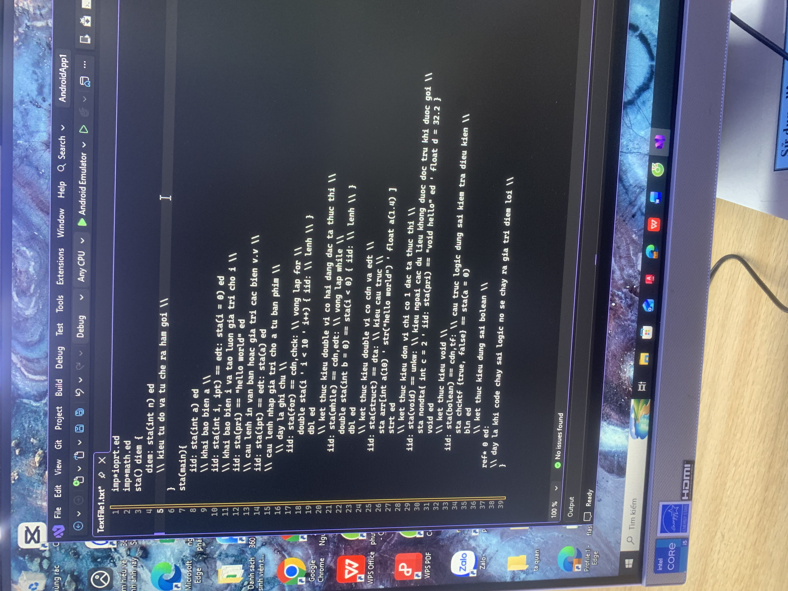

  

<h1 align="center">Ngôn ngữ lập trình Sd / Sd++</h1>

  <strong>Học Sd / Sd++ · Learn Sd / Sd++</strong>

> **Bắt đầu học ngay · Start learning now**
>
> | 🇻🇳 Giáo trình tiếng Việt | 🇬🇧 English textbook |
> |---|---|
> | **[📥 Giáo trình tiếng Việt v3 (PDF)](Giao_trinh_Sd_Sdpp_v3.pdf?raw=1)** · [Bản tiếng Việt trước đây](giaotrinhsd%3Asdpp.pdf?raw=1) | **[📥 Open / download the English PDF](Sd_Sdpp_Programming_Textbook_English%20(1).pdf?raw=1)** |
>
> **[▶ Mở IDE Sd/Sd++](Sd%20IDE.html)** · [Xem ví dụ Sd](examples/sd/) · [Xem ví dụ Sd++](examples/sdpp/)

Chào mừng bạn đến với repository học Sd/Sd++. Chọn ngôn ngữ để xem hướng dẫn đầy đủ:

- 🇬🇧 **[Learn Sd / Sd++ in English](docs/en/README.md)**
- 🇻🇳 **[Học Sd / Sd++ bằng tiếng Việt](docs/vi/README.md)**

## Bắt đầu nhanh

Mở [`Sd IDE.html`](Sd%20IDE.html), chọn **Mở tệp**, rồi chọn ví dụ trong [`examples/sd/`](examples/sd/) hoặc [`examples/sdpp/`](examples/sdpp/). Nhấn **Chạy** để thực thi chương trình.

Sd/Sd++ dùng cú pháp riêng của dự án, không phải C/C++. Mã ví dụ và tài liệu tham khảo được sắp xếp thành các tệp riêng để dễ tìm, chỉnh sửa và học tập.
